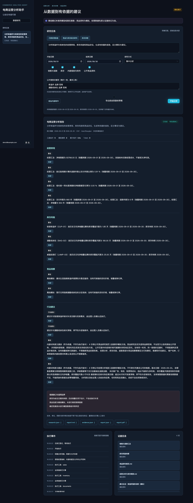

# 电商运营分析助手 | commerce-analysis-agent

产品名：**电商运营分析助手**；项目目录/仓库名：`commerce-analysis-agent`。
完整介绍名：**电商运营分析与竞品研究 Agent 系统**。
命名与迁移记录见 [项目命名](docs/10-project-naming.md)。

结合销售、退款、库存、内部规则和公开竞品资料，生成区分事实、分析与建议的报告。
关键结论关联原文或确定性指标；长任务可以复核、取消、恢复，并交付 Markdown/PDF。

基于 [didilili/deepsearch-agents](https://github.com/didilili/deepsearch-agents) 二次开发，
来源与实际贡献见 [PROVENANCE](PROVENANCE.md)。定位为可复现学习、求职展示及小规模试用。
最新验证范围见 [第二轮验收记录](docs/09-validation-round2.md)，不将模拟结果当作真实模型效果。



## 主要能力

- LangGraph 组织计划、资料获取、草稿、校验、复核和交付；复杂研究使用 Deep Agents。
- 固定资料流程、单 Agent、专家分工三种策略可选；关闭默认通用子 Agent，支持受控对比。
- 经营指标由受限业务工具计算，身份来自服务端，模型不能执行任意 SQL。
- Skills、结构化输出、上下文隔离、持久化检查点与人工 interrupt/resume。
- 商品/单位/周期/快照与指标绑定，关键事实句由程序渲染；研究发现保留逐字引用与冲突。
- 来源/片段/指标/内容哈希独立保存，证据选择清单、失败修正与明确降级。
- PostgreSQL 任务队列、租约与晚到结果校验、幂等提交、取消、事件游标重放。
- Cookie 登录、CSRF、资源归属、公开关键词边界、受限附件解析。
- React 工作台、PDF 导出、固定评估集、真实 SDK 协议测试、故障注入和 CI。

技术：Python3.12、Deep Agents0.7.25、LangChain1.4.5、LangGraph1.2.15、FastAPI、
SQLAlchemy/Alembic、PostgreSQL16、React19、TypeScript、Vite、Playwright。依赖由 uv/pnpm 锁定。

## 五分钟本地启动

需要 Python3.12、uv、Node22+、pnpm11.25.0。没有模型密钥也能跑明确标识的 demo：
以下命令均从 `commerce-analysis-agent` 项目目录开始。

```bash
cp .env.example .env
uv sync --frozen --python 3.12
uv run python scripts/dev_backend.py
```

另一个终端：

```bash
cd frontend
pnpm install --frozen-lockfile
pnpm dev
```

打开 [本地工作台](http://localhost:5173)，登录 `demo@example.com` / `demo-commerce-2026`。
默认业务数据覆盖2026-08-02至09-30，库存快照为09-30；竞品是模拟资料。
选择月度经营/库存/综合研究，点击“依据”核对数字，勾选草稿复核可体验暂停与恢复。

**demo 未调用模型或真实搜索；live 需要自己配置兼容模型与外部服务。**
真实联调及评估步骤见 [评估文档](docs/04-evaluation.md)。

## PostgreSQL 容器版

```bash
cp .env.example .env
# 保持默认值只用于本地演示；正式部署前设置独立凭据。
docker compose --env-file .env -f docker/docker-compose.yaml up -d --build
```

打开 [容器工作台](http://localhost:8080)。数据库和文件卷持久化，API/Worker 分离。
容器、HTTPS、账户和数据导入说明见 [部署文档](docs/05-deployment.md)。

## 阅读顺序

1. [架构与边界](docs/01-architecture.md)：流程/Agent、状态/检查点、预算与取舍。
2. [源码调用链](docs/02-code-walkthrough.md)：一条请求经过哪些模块，每层保证什么。
3. [六周学习路线](docs/03-learning-roadmap.md)：每阶段需要解释、修改与验证的内容。
4. [评估与真实联调](docs/04-evaluation.md)：固定用例、人工核验、三种策略比较。
5. [启动和部署](docs/05-deployment.md)、[最新验收记录](docs/09-validation-round2.md)。
6. [上传 GitHub 与成果整理](docs/07-publishing.md)：来源、凭据检查和简历边界。
7. [第二轮开发文档](docs/08-development-plan.md)：问题根因、实现约束与逐项验收标准。

## 项目结构

```text
app/
  core/          配置、认证、文件边界与解析
  commerce/      经营计算、词法检索、样例与数据导入
  storage/       业务表、任务、租约、证据和事件
  research/      Agent、Gateway、LangGraph、Schema及校验
  skills/        经营复盘与竞品研究流程
  tasks/         独立 Worker 与检查点连接
  api/           登录、任务、附件、事件、依据与下载
frontend/        工作台和浏览器验收
migrations/      Alembic 迁移
data/           明确标注的经营/竞品/文档样例
tests/          业务、安全、SDK协议、恢复、PostgreSQL测试
evaluations/    32条固定用例、人工标注及三策略比较器
docker/         API/Worker/PostgreSQL/前端/HTTPS配置
docs/           架构、学习、部署、评估与验收
```

历史 examples/ 与部分知识库/图片保留用于上游对照，不属于新主应用的启动或验收入口。
完整历史复现需要使用其原始依赖环境，见 [示例说明](examples/README.md)。

## 验证

```bash
uv run ruff check app tests migrations evaluations scripts
uv run ruff format --check app tests migrations evaluations scripts
uv run pytest -q
uv run python -m evaluations.run --mode demo
uv run --with pgserver==0.1.4 python scripts/test_embedded_postgres.py tests
cd frontend
pnpm build
pnpm format:check
pnpm exec playwright install chromium
pnpm test:e2e
```

未提供 TEST_POSTGRES_URL 时 pytest 显式跳过 PostgreSQL 用例；临时 pgserver 或 CI 可运行。
脚本模型测试证明 SDK 协议连通性，离线32条用例证明固定业务契约；真实模型质量、真实
搜索/RAGFlow 与公网运行应分别验证，不从这些测试中推导生产成功率或性能。
