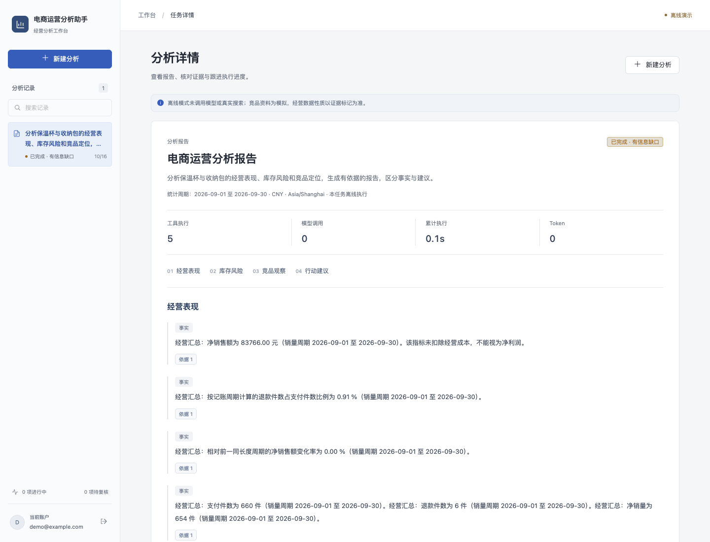

# 电商运营分析助手 | commerce-analysis-agent

产品名：**电商运营分析助手**；项目目录/仓库名：`commerce-analysis-agent`。
完整介绍名：**电商运营分析与竞品研究 Agent 系统**。
命名与迁移记录见 [项目命名](docs/10-project-naming.md)。

结合销售、退款、库存、内部规则和公开竞品资料，生成区分事实、分析与建议的报告。
关键结论关联原文或确定性指标；长任务可以复核、取消、恢复，并交付 Markdown/PDF。

基于 [didilili/deepsearch-agents](https://github.com/didilili/deepsearch-agents) 二次开发，
来源与实际贡献见 [PROVENANCE](PROVENANCE.md)。定位为可复现学习、求职展示及逐步走向小规模试用。
当前默认主入口为**经营复盘（固定流程）**：生成模拟场景或导入CSV，确认不可变数据版本，
检查质量并生成可核对报告。程序计算事实与变化观察，AI选择受控假设并提出核对建议。
使用、数据契约、开发与验收边界见[经营复盘开发与验证](docs/21-commerce-review-development-validation.md)。
本轮251条后端、9条新离线、原32条离线和11条Chrome检查通过；
真实模型九场景及两个场景各两次重复经过自动检查与逐条证据核对。
模拟数据结果不代表真实业务效果，Docker/目标HTTPS仍待验；详见21号文档。
以下214条等是此前审计批次记录。
2026-10-16已修复恢复快照、库存精度、附件检索、文档配额、代理信任配置及前端证据读取竞态，
本地214条后端、32条离线评估与9条Chrome浏览器检查通过，范围见[审计修复与验证](docs/20-audit-fixes-validation.md)。
此前纯Python交付与负载见[历史交付验收](docs/18-python-delivery-validation.md)。
f3a12de的库存、内部规则、综合补货三个真实教学单例见[模型记录](docs/16-usage-receipts-and-provider-check.md)，
它们是原实现的历史证据，本轮没有新增真实模型复测；不代表新实现模型效果、稳定通过率或生产验收。

浅色工作台的界面、交互与本地验证见[前端重构记录](docs/22-frontend-redesign.md)。



## 主要能力

- LangGraph 组织计划、资料获取、草稿、校验、复核和交付；复杂研究使用 Deep Agents。
- 固定资料流程、单 Agent、专家分工三种策略可选；关闭默认通用子 Agent，支持受控对比。
- 经营指标由受限业务工具计算，身份来自服务端，模型不能执行任意 SQL。
- Skills、结构化输出、上下文隔离、持久化检查点与人工 interrupt/resume。
- 商品/单位/周期/快照与指标绑定，关键事实句由程序渲染；研究发现保留逐字引用与冲突。
- 同任务、同工具与周期复用首次可用指标快照；来源使用结构化文档/片段身份与显式排除原因。
- 来源/片段/指标/内容哈希独立保存，证据选择清单、失败修正与明确降级。
- PostgreSQL 任务队列、租约与晚到结果校验、幂等提交、取消、事件游标重放。
- Cookie 登录、CSRF、资源归属、公开关键词边界、受限附件解析。
- React 工作台、PDF 导出、固定评估集、真实 SDK 协议测试、故障注入和 CI。
- SQLite/PostgreSQL离线备份恢复、可信备份校验与隔离HTTP教学负载入口。

技术：Python3.12、Deep Agents0.7.25、LangChain1.4.5、LangGraph1.2.15、FastAPI、
SQLAlchemy/Alembic、PostgreSQL16、React19、TypeScript、Vite、Playwright。依赖由 uv/pnpm 锁定。

## 五分钟本地启动

需要 Python3.12、uv、Node22+、pnpm11.25.0。没有模型密钥也能跑明确标识的 demo：
以下命令均从 `commerce-analysis-agent` 项目目录开始。

```bash
cp .env.example .env
uv sync --frozen --python 3.12
uv run python scripts/dev_backend.py
```

另一个终端：

```bash
cd frontend
pnpm install --frozen-lockfile
pnpm dev
```

打开 [本地工作台](http://localhost:5173)，登录 `demo@example.com` / `demo-commerce-2026`。
默认业务数据覆盖2026-08-02至09-30，库存快照为09-30；竞品是模拟资料。
默认先选择模拟场景，生成预览并“确认使用此数据版本”，查看质量检查后开始复盘。
点击“依据”核对数字，勾选草稿复核可体验暂停与恢复。库存和竞品在“库存与竞品研究（高级）”。

**demo 未调用模型或真实搜索；live 需要自己配置兼容模型与外部服务。**
真实联调及评估步骤见 [评估文档](docs/04-evaluation.md)。

## PostgreSQL 容器版

```bash
cp .env.example .env
# 保持默认值只用于本地演示；正式部署前设置独立凭据。
docker compose --env-file .env -f docker/docker-compose.yaml up -d --build
```

打开 [容器工作台](http://localhost:8080)。数据库和文件卷持久化，API/Worker 分离。
容器、HTTPS、账户和数据导入说明见 [部署文档](docs/05-deployment.md)。

## 阅读顺序

学习只需从 [学习总览](docs/learning/01-总览.md) 开始，依次阅读 **总览 → 后端主链 → Agent与证据 → 实践与自测**，共 4 篇。六周安排和面试题已合入，不需要另外走一套路线。

其他文档按需查阅：

- **查设计和源码：** [架构与边界](docs/01-architecture.md)、[源码调用链速查](docs/02-code-walkthrough.md)。
- **使用和部署：** [经营复盘数据与验证](docs/21-commerce-review-development-validation.md)、[评估与真实联调](docs/04-evaluation.md)、[启动和部署](docs/05-deployment.md)。
- **核对历史证据：** [审计修复验证](docs/20-audit-fixes-validation.md)、[历史交付验收](docs/18-python-delivery-validation.md)、[模型验证](docs/16-usage-receipts-and-provider-check.md)。这些记录不需要逐篇学习。
- **开发与发布：** [第二轮开发文档](docs/08-development-plan.md)、[上传 GitHub 与成果整理](docs/07-publishing.md)。

## 项目结构

```text
app/
  core/          配置、认证、文件边界与解析
  commerce/      经营计算、词法检索、样例与数据导入
  storage/       业务表、任务、租约、证据和事件
  research/      Agent、Gateway、LangGraph、Schema及校验
  skills/        经营复盘与竞品研究流程
  tasks/         独立 Worker 与检查点连接
  api/           登录、任务、附件、事件、依据与下载
frontend/        工作台和浏览器验收
migrations/      Alembic 迁移
data/           明确标注的经营/竞品/文档样例
tests/          业务、安全、SDK协议、恢复、PostgreSQL测试
evaluations/    32条固定用例、人工标注及三策略比较器
docker/         API/Worker/PostgreSQL/前端/HTTPS配置
docs/           架构、学习、部署、评估与验收
```

历史 examples/ 与部分知识库/图片保留用于上游对照，不属于新主应用的启动或验收入口。
完整历史复现需要使用其原始依赖环境，见 [示例说明](examples/README.md)。

## 验证

```bash
uv run ruff check app tests migrations evaluations scripts
uv run ruff format --check app tests migrations evaluations scripts
uv run pytest -q
uv run python -m evaluations.commerce_review --mode demo --output evaluations/results/my-review-demo
uv run python -m evaluations.run --mode demo
uv run --with pgserver==0.1.4 python scripts/test_embedded_postgres.py tests
cd frontend
pnpm build
pnpm format:check
pnpm exec playwright install chromium
pnpm test:e2e
```

未提供 TEST_POSTGRES_URL 时 pytest 显式跳过 PostgreSQL 用例；临时 pgserver 或 CI 可运行。
脚本模型测试证明 SDK 协议连通性，离线32条用例证明固定业务契约；真实模型质量、真实
搜索/RAGFlow 与公网运行应分别验证，不从这些测试中推导生产成功率或性能。
