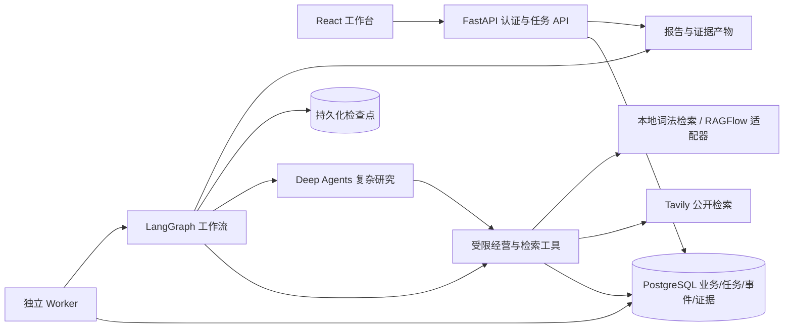

# 架构与业务边界

系统面向电商运营，围绕经营复盘、库存风险、竞品比较生成可核对的报告。
输入包括任务目标、周期、允许来源、独立公开关键词与可选附件。
首版只分析并生成文件，不采购、不改价、不写业务订单、不发送对外消息。

## 架构

React 展示历史、事件、报告、证据和文件。API 负责认证、范围验证、幂等登记、
取消及复核。Worker 领取任务、维护租约、运行工作流。PostgreSQL 是部署存储；
SQLite 是可复现本地开发/测试后端，使用短事务串行锁，不能据此声称多实例扩展能力。

## 确定性流程与 Agent

流程：`plan → collect → draft → validate → review → export`。

- plan 产生结构化计划；允许来源和公开关键词来自用户请求，模型在范围内选择来源，
  不能扩大权限。纯经营指标任务使用确定性计划，避免额外规划调用。
- collect 确定性获取经营指标和必要内部资料。复杂公开研究才进入 Deep Agents。
- collect 将研究结果归纳为带逐字原文引用的发现/冲突/缺口，保存到图状态并传入draft；
  摘录存在不证明推理正确。上下文记录来源选择、窗口和遗漏，不按前18条简单截断。
- draft 将证据转换为结构化报告。demo 使用模板，live 使用模型；经营指标引用必须
  绑定实体、单位、周期与快照，关键数字事实句由代码生成，分析推断仍需核验。
- validate 检查章节、引用归属和数字。live 可进行模型语义评审。
- 错误草稿最多修正一次，仍失败则回退到确定性指标与原文摘录，并保留缺口。
- review 使用 LangGraph interrupt 暂停；用户批准/驳回通过 Command.resume 恢复。
- export 由程序生成文件，模型没有文件写入或代码执行权限。

workflow直接按允许关键词收集资料，使用相同归纳/报告/校验，作为对照基线。
单 Agent 模式关闭默认 general-purpose 子 Agent。多 Agent 模式提供市场与内部规则
专家，是否真正委派由模型决定；需要通过执行事件确认实际调用，不能只看配置。
当前是本地工具式子 Agent 委派，未实现独立远程 AsyncSubAgent 生命周期。

内部词法检索覆盖授权语料，超过10000片段则明确拒绝并提示建立索引。库存按风险排序
后取100个并披露截断，日期记录不完整时不估计覆盖天数；当前商品目录每天应有记录，
暂未建模上架/下架生命周期。工具之间仍没有共享一致性快照。

## 状态与恢复

任务状态：queued、running、waiting_review、cancelling，以及 succeeded、degraded、
failed、cancelled、rejected 五种终态。degraded 表示有明确缺口，不等于执行失败。

会话和任务分别编号；每轮分析是一个独立任务，前端会话附件可以复用。
业务任务表和 LangGraph 检查点分开：前者管理排队/租约/取消/预算，后者保存图状态。
外层工作流使用 task_id，研究子图使用 `task_id:research`，防止检查点互相覆盖。

PostgreSQL 使用 `FOR UPDATE SKIP LOCKED` 领取任务，每次领取生成随机 lease_token。
执行写入必须校验 token、有效期及状态，旧 Worker 不能提交晚到结果。租约到期后，
新 Worker 根据检查点恢复；已完成图节点不重新规划。领取次数受 MAX_ATTEMPTS 限制，
正常人工复核继续执行也会产生一次新领取。

执行语义为至少一次，不是 exactly-once。节点内尚未完成的外部请求可能重复；证据
按内容/定位去重，产物按任务与名称登记。每次租约使用独立文件目录，晚到文件不会
覆盖当前登记产物。SIGKILL 导出恢复已测试；其他任意崩溃窗口仍须按验收用例验证。

## 预算与观测

业务工具调用、模型调用、已返回 Token、领取次数与累计完成阶段耗时持久化。
每个阶段有绝对截止时间，重启恢复不重置该阶段截止时间；等待人工复核不计执行时间。
进程被硬杀前尚未落库的耗时不会完整计入展示指标，但截止时间仍可约束恢复。
模型请求在模型边界计数，包含 SDK 摘要调用；callback 设置 raise_error 才能阻止
超额请求。启动恢复时发现已登记请求没有用量回执，会按未知用量处理。

模型调用/工具调用次数为硬限制。MAX_TOKENS 是按提供方返回用量在下一次调用前
检查的阈值，单次调用可能跨过阈值，不是绝对费用封顶。模型输出每次至多3000 Token；
提供方未返回用量或调用异常时标记不完整，停止后续模型调用，费用显示未知。
工具计数只涵盖业务 Gateway，不包含 SDK 的 Todo/文件读取工具。

事件保存模型开始/结束、委派、工具阶段、错误类型、复核与终态，默认不保存原始
模型思考过程。API 支持游标查询和 SSE 重放；当前前端使用游标轮询恢复事件。
可配置模型 Token 单价估算费用，计算不包含 Tavily/RAGFlow 等服务费用。

## 前沿能力与取舍

采用 Deep Agents 0.7.25 / LangChain 1.4.5 / LangGraph 1.2.15，使用 Skills 渐进加载、
上下文隔离、结构化输出、人工中断与持久化。升级时必须复测工具权限、默认子 Agent、
检查点与输出 Schema。

未引入自动长期记忆、远程子 Agent、MCP/A2A、可执行代码沙箱或自动业务写操作。
在用户需求、权限与收益验证后再扩展，避免给首版增加无法解释的复杂度。

参考：[LangGraph 工作流](https://docs.langchain.com/oss/python/langgraph/thinking-in-langgraph)、
[持久化](https://docs.langchain.com/oss/python/langgraph/persistence)、
[Deep Agents 上下文](https://docs.langchain.com/oss/python/deepagents/context-engineering)。
