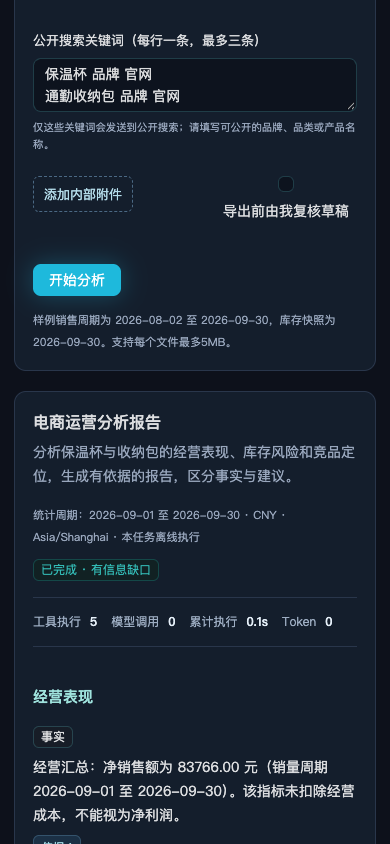

# 本次验证记录

日期：2026-10-14。范围：本地代码、固定样例、隔离数据库与本机浏览器。
本记录属于开发验收，不构成生产验收，也不证明真实模型的研究质量。
基线为上游提交 `d0f6eed1e14b1b457942ba2a0195f65731aaf444`；本次改造尚未提交或推送。

## PASS：已执行并通过

| 检查 | 结果 | 实际验证范围 |
| --- | --- | --- |
| Python 自动化测试 | 27 passed，12.26秒 | 24条通用测试与3条 PostgreSQL 测试，包含下列协议与恢复场景 |
| PostgreSQL | 本机临时 PostgreSQL 16.2 | 随机 schema 和非超级用户应用角色；迁移、并发领取、租约、预算、检查点、人工复核与 API/PDF |
| 固定离线评估 | 20/20 | 报告中的实际数字、指标引用、章节、来源使用与信息缺口；确定性 demo |
| 浏览器流程 | 1 passed，13.3秒 | Chrome 中登录、真实 API/Worker、草稿复核、证据抽屉、PDF 下载、刷新重放及390px布局 |
| 前端构建 | TypeScript / Vite 通过 | 本机 Node26、pnpm11.25.0；CI 配置为 Node22，尚未执行远程 CI |
| 静态检查 | Ruff、Prettier、diff 检查通过 | 当前主应用、测试、迁移、评估、脚本与前端 |
| PDF 人工视觉检查 | 3页通过 | 中文报告、分页、证据目录；未发现文字遮挡、裁切或乱码 |
| 页面人工视觉检查 | 桌面/移动截图通过 | 报告、依据、事件、信息缺口、下载；移动端无横向溢出 |

固定评估生成时间为 `2026-10-14T05:50:46Z`。中位执行耗时16ms，仅代表模板和本地工具，
不能用作模型延迟、生产吞吐或线上 SLA。完整请求/任务/报告/证据保留在本地
`evaluations/results/demo-validation.json`，该运行目录被 Git 忽略。

后端覆盖的关键契约：

- 净销售额、退款件数比例、净销量、库存覆盖天数与缺失数据；导入校验及幂等。
- 登录、CSRF、Origin、幂等创建、用户与组织资源归属、附件路径及大小边界。
- 实际 Deep Agents/LangGraph SDK 的单 Agent、具名专家、只读 Skills 与工具调用协议；
  测试使用脚本模型，未替代真实模型质量验证。
- 模型回调覆盖 SDK 摘要调用，缺失用量停止后续调用，预算并发计数与租约写入隔离。
- 数字/引用错误、空章节、受控修正与确定性回退；回退不算 live 研究成功。
- 独立 Worker 人工暂停/恢复、取消、过期租约及导出阶段进程被 SIGKILL 后重新领取。
  故障注入仅证明所测场景；外部工具仍可能重复调用。
- JSON/SSE 游标重放、带权限的产物下载、迁移升级/降级，以及 RAGFlow 返回字段和
  数据集归属的模拟 HTTP 契约。

经营样例的人工交叉核对：2026年9月支付660件、退款6件、净销量654件，净销售额
83766.00元，退款件数比例0.91%；收纳包/保温杯/阅读灯库存覆盖分别为180.00/1.85/25.00天。
这些均为教学模拟数据，未扣除成本的净销售额不能写成净利润。

## FAIL：当前已知未通过项

本轮已执行的检查没有遗留 FAIL。下列项目没有执行，必须分别记为 BLOCKED/未验，
不能因本地测试通过而改记 PASS。

## BLOCKED / 未验

| 项目 | 原因及完成条件 |
| --- | --- |
| 真实模型、Tavily、RAGFlow 联调 | 本次没有配置真实凭据；按04文档运行 live 用例并人工逐条核对来源与结论 |
| 单/多 Agent 质量与成本对比 | demo 不进行真实委派；需固定模型、预算和数据，重复至少3轮并保存证据 |
| Docker 镜像与 Compose 启动 | 本机没有 Docker；只检查了 YAML/配置，容器烟测脚本和 CI 已提供但未实际执行 |
| 公网 HTTPS | 没有域名和部署主机；证书、Cookie、代理、数据库/文件卷恢复需在目标环境验证 |
| GitHub Actions | 尚未上传或触发；工作流配置不等于 CI 已通过 |
| 负载、高可用及生产业务 | 未执行；本次不提供线上成功率、吞吐量或可用性承诺 |

## 当前实现边界

- 本地文档检索是小语料词法基线，最多读取2000个候选片段；库存接口最多100个商品，
  每章节最多8条结论。扩展数据量前需要分页/检索评估，不能直接推广样例结果。
- 数据工具之间没有共享的数据库一致性快照；报告保存各次计算的证据，不能当作同一
  时刻的财务审计报表。样例仅包含3个SKU、2份内部文档及模拟竞品资料。
- Worker 是至少一次执行。`MAX_TOKENS` 是下一次调用的准入阈值，单次输出与未返回
  用量会产生超限/未知区间，不能称为提供方账单的绝对硬上限。
- 附件解析有资源/时间约束和独立进程，但不是操作系统安全沙箱；原始上传文件不归档。
- 尚无完整 IAM、自助密码重置、自动保留周期、对象存储、备份恢复演练或高可用调度。
- 引用、数字校验和模型语义复核均不能证明原文真实、推断正确；重要结论仍需人工核对。
- 保留上游来源及 AI 辅助说明；原始快照未发现许可证文件，发布前须核实使用许可。

## 可重复命令

```bash
uv sync --frozen --python 3.12
uv run ruff check app tests migrations evaluations scripts
uv run ruff format --check app tests migrations evaluations scripts
uv run pytest -q
uv run --with pgserver==0.1.4 python scripts/test_embedded_postgres.py tests
uv run python -m evaluations.run --mode demo --output evaluations/results/demo-validation.json
cd frontend
pnpm install --frozen-lockfile
pnpm format:check
pnpm build
pnpm exec playwright install chromium
pnpm test:e2e
```

无 TEST_POSTGRES_URL 的普通 pytest 会跳过3条 PostgreSQL 测试。临时 pgserver 脚本
运行真实数据库用例；平台若不支持该发行包，使用一次性 PostgreSQL16 服务。
本机浏览器验证设置了 `COMMERCE_BROWSER_CHANNEL=chrome`，使用隔离测试配置。


