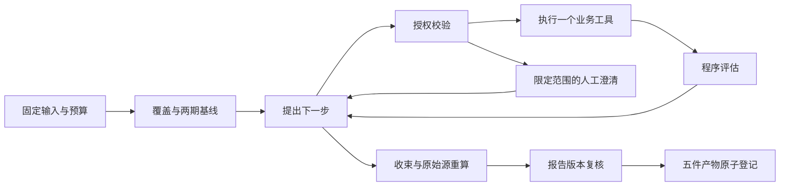

# 经营诊断源码与验证路线

对应 `docs/commerce-diagnosis-spec-v1.1.md`，更新于 2026-10-19。
这是当前实现的阅读入口与练习，不代表本人已独立完成练习、真实模型通过或生产验收。

## 从一次请求追到报告

1. `app/api/server.py` 的 `POST /api/analysis-inputs` 接收已确认销售版本、显式两期、允许的 SKU/品类，
   可选库存版本与文档清单。`inputs.create_bundle` 检查来源所有权和内容哈希，再按规范内容去重。
2. `POST /api/tasks` → `TaskRequest` → `Repository.create_task`。服务器固化 bundle hash、版本、预算与执行模式。
   诊断使用 `commerce_diagnosis` / `diagnostic`，不接受公开搜索或任意 SQL。
3. `Repository.claim` 领取 Task 并签发 lease token。`Worker.process` 按 profile 构建新诊断图，
   检查点仍使用原来的 task thread 和 `LeaseFencedSaver`。
4. `graph.resolve_inputs` 从固定输入生成初始范围；`baseline_inspect` 检查覆盖，
   `baseline_compare` 核对两期已记录值。库存或规则问题可在销售对比不足时继续取得相应证据，缺口仍保留。
5. `propose` 每次只产生一个 `StepProposal`；`authorize` 校验目录、参数和当前范围；
   `execute_tool` 经过统一工具网关；`assess` 依据程序规则和新信息判断继续、收束或停止。
6. `assemble` 由程序绑定数值与观察；`DiagnosisStore.save_report` 从原始来源重算证据并核验报告。
   `review` 将人工决定绑定到报告 hash；`export` 成组发布 MD/JSON/PDF、证据与轨迹共五件产物。



边界与停止判断位于代码中。图上的箭头不能绕过 8 步、10 次工具、12 次模型的持久预算，
服务器配置可以进一步降低限额。等待人工答复不计执行时间；故障接管也不会清零既有消耗。

## v1 与 v2 怎么共存

| 内容 | 销售 v1 | 扩展 v2 |
| --- | --- | --- |
| 选择 | 只有 sales 来源，且没有库存/规则意图 | 选择库存/文档来源，或明确询问库存/规则 |
| 图和 Prompt | diagnosis-v1 | diagnosis-v2 |
| 报告/工具注册表版本 | 1 / 1 | 2 / 2 |
| 结构化提议 | `schemas.StepProposal` | `schemas_v2.StepProposalV2` |
| 目录 | 五个销售工具 | 销售工具，加上任务实际授权的扩展工具 |
| 特有报告字段 | 销售事实与确定性观察 | `snapshot_as_of`、规则原文、未核验解读与冲突候选 |

`contracts.accepted_versions` 决定新任务版本；`build_diagnosis` 同时校验四个版本字段。
未知版本直接失败，不把旧 checkpoint 当新 schema 继续。
`tests/fixtures/diagnosis_v1_contract.json` 固定原 v1 Schema、工具目录与 Prompt 的 hash，
另有旧模型输出落库后复用、旧图 SIGKILL 恢复等行为测试。不要通过更新 golden 文件掩盖不兼容改动。

输入包 schema 与执行 schema 是两个概念。schema 2 组合包只要绑定扩展来源即可成立，
但任务只选择 sales 时不会获得库存或文档工具。仅询问库存而没有绑定库存时会生成缺口，不读取旧产品表补数。

## 一次工具调用中的四个身份

| 身份 | 含义 | 主要落点 |
| --- | --- | --- |
| bundle_id / hash | 不可变业务输入、两期及允许范围 | `analysis_input_bundles` |
| query spec hash | 当前任务、来源 hash、工具版本、有效过滤及两期的规范查询 | `tool_query_results` |
| call_id / attempt | 这一次真实执行尝试及 lease | `tool_invocations` |
| evidence_id | 同一规范结果的可追溯证据 | `evidence` |

`tools.DiagnosisToolGateway.invoke` 先复验权限，再验证参数、规范过滤、查缓存和预占预算。
成功结果、Evidence 与调用状态在 `_publish` 的同一事务提交。
成功结果在 checkpoint 之前已经提交时，恢复会复用原 call_id；缓存命中仍复验权限和源内容。
撤权、源内容变化或另一用户的 ID 都不能因曾经命中过缓存而放行。

销售工具的来源 hash 是 sales；库存代理是 sales + inventory；规则检索是 documents。
`validation.verified_evidence` 核对规格、结果与内容 hash，并用固定原始输入重新执行纯计算，
不是只检查报告数字能在某处找到。

## 为什么模型和工具需要不同账本

本地纯计算可以在失败后重算；模型请求可能已经产生费用，却没来得及提交响应。
`model_calls.DiagnosisModelGateway` 在发送前持久预占，在同一事务记录结构化输出与 usage。
调用身份由 task / step / phase / attempt 确定，同时绑定模型、Schema 与 Prompt hash。

接管时若只有 STARTED 没有已提交响应，即使可能死在发送前，也按 UNKNOWN 处理并停止新模型调用。
这保留了费用不确定性，不自动重试。已成功提交的输出则复用，不再请求供应商。
新模型网关复用原 Repository 预算原语，并移除该单次请求上的旧 RuntimeModelMeter 回调，防止重复扣账。

阅读对应测试：`test_diagnosis_model_calls.py`、`test_diagnosis_recovery.py`、
`test_diagnosis_runtime_postgres.py`。协议替身测试只能验证这些边界，不能测量真实模型诊断效果。

## 库存和规则能证明什么

`extensions.inventory_risk` 使用完整本期窗口的支付件数 / 天数作为需求代理。
它不会把退款自动当成回库，不读取采购在途或多仓信息，也没有企业安全库存系数。
覆盖天数代理是可用库存 / 日均支付件数代理；风险判断用整数交叉乘积，避免四舍五入改变分类。
新品未覆盖完整窗口、缺行、零支付、过旧/未来快照、缺 SKU 或提前期各有明确状态。
快照日期与窗口日期分别展示，不声称不同来源来自同一事务时点。

`sources.create_manifest` 固定文档、片段、原文 hash 与原会话范围；
`extensions.search_rules` 仅词法检索这些片段，返回有 offset/hash 的逐字窗口。
`validation_v2` 的规则观察始终不足以确认适用性；不同阈值仅为未核验冲突候选。
模型可以提供带已有 quote 引用的解读，但 `status` 只能是 unverified。
人工批准导出报告不会把这种解读转成已验证语义，更不能证明实际经营原因。

## API 操作顺序

- 销售：`POST /api/commerce/datasets/preview` → `POST /api/commerce/datasets/{id}/commit`。
- 库存：`GET /api/inventory/template` → `POST /api/inventory/datasets/preview` →
  `POST /api/inventory/datasets/{id}/commit`。CSV 固定列为 `sku,snapshot_day,available_units,lead_days`。
- 文档：原 `POST /api/documents` 上传到本人会话；`GET /api/documents?conversation_id=…` 选择可见资料；
  `POST /api/document-manifests` 固定 document_ids 和 conversation_id。
- 组合：`POST /api/analysis-inputs` 指定确认后的来源和两期；创建任务时传 bundle_id。
- 提交前核对：`GET /api/analysis-inputs/{id}/quality` 按该组合的真实两期与授权范围返回覆盖、库存缺口、资料性质和不支持指标；
  该读取不创建Task、不消耗调用额度。网页更改数据/周期/范围后须核对当前组合，勾选确认后才可开始。
- 跟踪：`GET /api/tasks/{id}/diagnosis` 返回步骤、发现、预算、报告版本与 pending_input。
- 澄清：`POST /api/tasks/{id}/clarifications` 传 interrupt_id、expected_version、原选项中的 choice。
- 复核：`POST /api/tasks/{id}/review` 传 interrupt_id、expected_version、当前 report_hash 和 approved。
- 反馈：`POST /api/tasks/{id}/feedback` 带 expected_version，可附 finding_id；反馈不修改原报告。

所有写接口沿用登录、Cookie、来源校验和 CSRF。新清单必须与任务原会话匹配；
更换来源应创建新输入和新任务，不在旧线程中换数据继续。

固定基线可创建 `profile=commerce_review`、`strategy=workflow`、`sources=[sales]` 并传相同bundle_id。
服务器将销售ID、两期和允许SKU固定到该任务，`review_inputs.py` 在原Worker中适配 `calculate_periods`。
原dataset-only入口仍使用相邻前一期。新适配只覆盖共同销售能力，不额外赋予旧流程库存/规则/动态日下钻。
同bundle本身不证明两份结论公平：还要核对模型/预算、最终与基线事实范围和共同问题分组。

## 评测与维护调用链

`evaluations.diagnosis` 载入固定分集→仅业务字段进入 `diagnosis_runtime`→真实Worker执行→`diagnosis_oracle`按原始记录重算→`diagnosis_grading`断言→保留逐次回执。
`RequestBudget` 在HTTP前做整轮预留并追加journal，响应后严格核验usage；不能按Task重置或给UNKNOWN退款。
`diagnosis_review` 核对独立审查人、回执/预期hash、逐项引用及完整重复，再判断是否满足放行条件；不改变产品默认入口。
前端 `DiagnosisComparison` 复用本人任务详情和证据API，比较同包、两期、范围及预算；范围不同不直接比金额。

停服后 `diagnosis_state_audit` 核对版本、源内容、调用账本、报告/文件与等待checkpoint。
`backup_local` / `backup_postgres` 在备份前后及恢复发布前使用该审计；PG同一次dump包含业务与checkpoint表。
`cleanup_artifacts` 默认dry-run，仅显式停服apply删除陈旧孤立文件；`load_smoke --profile commerce_diagnosis` 只运行自建临时PG/API/Worker环境。
精确命令与边界见26、27号文档。

## 独立复现与个人练习

本地测试不需要任何模型密钥：

```sh
.venv/bin/python -m pytest tests/test_diagnosis_extensions.py tests/test_diagnosis_versions.py -q
UV_CACHE_DIR=.uv-cache uv run --frozen --with pgserver==0.1.4 python scripts/test_embedded_postgres.py tests
```

第二条会启动临时本地 PostgreSQL/HTTP 测试服务。受限环境需允许本地监听。
该命令使用测试 schema 与非超级用户角色，不接入业务数据库。

建议本人逐项完成并保留自己运行的输出，而不是把本文件当作完成证据：

1. 从请求定位到一个 SKU 日下钻的过滤、query hash、Evidence 和报告事实。
2. 对一份独立手算数据修改退款件数而保持金额不变，解释为何金额与分母结论可能不同。
3. 修改 v2 的下一步选择或一个新信息判断，并验证 v1 golden、旧恢复及新边界全部通过。
4. 在库存工具成功落库后杀死 Worker，追踪原 call_id 如何复用及为什么工具额度没有增加。
5. 解释“原文存在”“未核验解读”“规则适用”“经营因果”四层各缺什么证据。

当前真实模型保留集、外部目标环境和业务人员核对分别记录，不能由上述本机结果替代。

## 最新版本入口（2026-10-20）

准入版本由`contracts.accepted_versions`和`Settings.diagnosis_runtime`固定到Task。默认v6沿用v3意图、v4有界停止修正、v5精确范围净额检查；旧Task仍按原版本分支处理。
`planner_v3.py`识别目标/否定约束；`planner_v4.py`指出可补齐的停止缺口；`planner_v5.py`要求澄清后重新绑定净额事实；`planner_v6.py`只切换新注册表契约。
`rule_retrieval_v2.py`只在已授权manifest内做有限同义词召回，`tools._calculate`与`validation.verified_evidence`根据注册表版本选择算法并重算；原`extensions.search_rules`保持不变。
当前修复、失败及验证证据见[29号记录](29-diagnosis-v3-repair.md)。

最终v7由`planner_v7.py`区分原文查阅与实际适用性核验，只有后者强制保留独立核验缺口；目标明确缩小后按所选目标判断，解读始终未核验。
