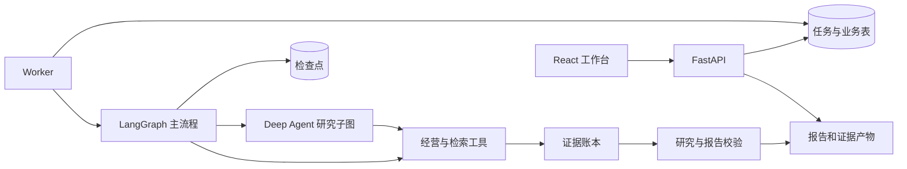

# 01 总览 · 电商运营分析助手学习路线

适合已经接触 Java 后端、刚开始学习 Python 和 Agent 工程的读者。目标是逐步做到：能运行、能沿源码解释、能定位失败、能做一个有验证的小改动，最后能用自己的话介绍项目。

本系列参照 CodeOJ 的“总览—模块—链路—成果测试—面试”写法，依据本仓库 `c3a5e30`（2026-10-15）源码编写。函数名是主要定位依据；后续改代码时，应同步核对文档。历史 `examples/` 用于上游对照，第一轮学习走 `app/` 主应用。

## 1. 先知道这个项目解决什么问题

用户选择分析周期、信息来源和目标，系统读取销售、退款、库存、内部规则及允许的公开资料，生成可核对的运营报告。报告区分事实、分析、建议，并能回到原文或确定性计算结果。

以九月库存诊断为例：程序计算每件商品的库存覆盖天数；模型组织解释和建议；程序检查指标引用；用户可以复核；最终交付报告与证据文件。系统不会直接采购、调价或修改订单。

你首先要分清三个问题：

| 问题 | 主要由谁负责 |
| --- | --- |
| 净销售额和库存覆盖到底是多少？ | 确定性业务工具与数据库 |
| 应选择哪些资料，怎样组织研究和解释？ | 工作流、受限 Agent 与结构化模型调用 |
| 能否访问、是否超预算、能否提交结果？ | 认证、Repository、Worker、校验器 |

## 2. 项目地图



| 目录 | 本轮先找的入口 | 责任 |
| --- | --- | --- |
| `app/api/` | `create_app` 内的 `start` | 接收请求、认证、返回任务 ID |
| `app/storage/` | `Repository.create_task/claim` | 排队、归属、幂等、租约、预算、结果 |
| `app/commerce/` | `sales_summary/inventory_risks` | 确定性计算、规则检索、数据导入 |
| `app/tasks/` | `Worker.process` | 执行、心跳、取消、超时和恢复 |
| `app/research/` | `build_workflow` | 流程、Agent、上下文、研究与报告 |
| `app/core/` | `Settings/authenticate/safe_path` | 配置、登录、文件边界 |
| `frontend/src/` | `App` 与 `api` | 提交、轮询、复核、依据和错误展示 |
| `tests/`、`evaluations/` | 先看具体断言 | 回归测试与业务评估 |

API 与 Worker 通过数据库里的任务记录协作；当前没有 RabbitMQ。LangGraph 检查点保存执行进度，不能代替业务任务队列。

## 3. 按什么顺序读

每次学习建议留出 60～90 分钟，完成一段有边界的阅读和一次复述。表中“轮次”是阅读顺序，不要求每天完成一篇。

| 轮次 | 阅读材料 | 这次必须交出的成果 |
| --- | --- | --- |
| 1 | [Python 与框架基础](02-模块/00-Python与框架基础.md) | 解释 `async/await`、Schema、事务与图状态 |
| 2 | [启动与项目结构](02-模块/01-启动与项目结构.md) | 跑通隔离 demo，指出 API 和 Worker 两个进程 |
| 3 | [接口认证与任务入库](02-模块/02-接口认证与任务入库.md) | 画登录到任务入库的链，解释 202 与幂等 |
| 4 | [经营工具与数据口径](02-模块/03-经营工具与数据口径.md) | 手算一个库存结果，说明缺数为什么不能补零 |
| 5 | [Worker 状态与故障恢复](02-模块/04-Worker状态与故障恢复.md) | 画租约接管时间线，指出晚到结果在哪被拒绝 |
| 6 | [LangGraph 流程与人工复核](02-模块/05-LangGraph流程与人工复核.md) | 给六个节点各写输入、输出和失败分支 |
| 7 | [Deep Agents、工具与预算](02-模块/06-DeepAgents工具与预算.md) | 区分三策略，定位模型请求准入与用量回执 |
| 8 | [证据、研究与报告校验](02-模块/07-证据研究与报告校验.md) | 从一个 Claim 追到事实目录或逐字原文 |
| 9 | [前端与任务诊断](02-模块/08-前端与任务诊断.md) | 解释刷新后的事件恢复和失败提示 |
| 10 | [评估、部署与备份](02-模块/09-评估部署与备份.md) | 给不同验证结果标出能证明和不能证明的内容 |
| 11～12 | [跨模块链路与成果测试](03-链路与阅读成果测试.md) | 闭卷画链路，回答故障场景，再对照判定要点 |
| 13～15 | [动手练习与调试](04-动手练习与调试.md) | 留下一份定位记录和一个经过验证的小改动 |
| 最后 | [面试与项目表达](05-面试与项目表达.md) | 用源码和证据支撑自己的回答 |

## 4. 每篇读三遍，每遍做不同的事

第一遍只读“业务问题”和有序入口，先知道模块接收什么、交出什么。第二遍打开链接，只读表格指定的函数，并记录谁调用它。第三遍关掉源码，回答篇末问题；答不出来再回到对应方法。

记录可以放在自己的笔记中，使用以下格式：

```text
业务问题：用户为什么会触发这段逻辑？
入口与调用者：文件 / 函数 / 上一层是谁
输入与输出：包含哪些身份、状态、证据 ID
持久化：写了哪张表、检查点或文件？何时提交？
失败与恢复：失败留下什么，下次从哪里继续？
验证依据：测试名、实际断言、是否使用替身
剩余疑问：下一次只解决一个问题
```

第一轮可以暂缓样式细节、全部 ORM 字段、PDF 排版细节和历史示例。`repository.py`、`graph.py` 较长，不需要从第一行背到最后一行，应按本文的函数顺序阅读。

## 5. 学习完成标准与证据边界

完成学习后，应能在不看文档时解释一次任务的正常链路和一次失败恢复；现场定位关键函数；修改一个受控功能并写出独立预期；区分继承代码、已有实现和自己实际完成的工作。

当前交付记录包含 187 条后端测试、32 条离线评估、8 条浏览器检查，以及三个真实模型教学单例。它们分别证明不同范围，不能合并成“生产验收通过”。详细数据以[交付验收](../18-python-delivery-validation.md)与[真实模型记录](../16-usage-receipts-and-provider-check.md)为准；本系列没有重新运行这些历史批次。

现有文档的分工：本系列负责“怎么读、怎么练”；[架构说明](../01-architecture.md)负责设计边界；[源码速查](../02-code-walkthrough.md)负责快速定位；[六周路线](../03-learning-roadmap.md)负责较长期安排；[部署文档](../05-deployment.md)负责实际部署命令。

**现在开始：打开[基础篇](02-模块/00-Python与框架基础.md)，先完成其三个小问题，再启动隔离 demo。**
