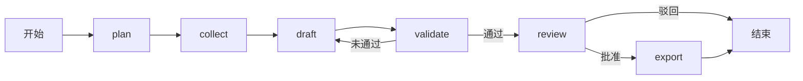

# 02 模块 · LangGraph 流程与人工复核

前置：[Worker 篇](04-Worker状态与故障恢复.md)。业务问题：怎样把长任务拆成可恢复的阶段，并在用户复核后继续执行？

## Part A：第一遍只读图的边

打开[graph.py](../../../app/research/graph.py) 的 `build_workflow`，先看末尾 `add_node/add_edge/add_conditional_edges`，再回头读节点。



需要人工复核时，review 内部会中断；无需人工复核时直接批准。不要把“校验通过的条件边”和“用户批准”理解成同一件事。

## Part B：第二遍读状态的生产与消费

`ResearchState(TypedDict, total=False)` 表示这些键不必从第一步全部存在。节点返回字典增量，后续节点读取前序产生的键；本图没有给这些字段配置列表累加 reducer，不能自行假定列表会自动追加。

| 节点 | 主要读取 | 主要返回 | 有哪些持久化或外部动作 |
| --- | --- | --- | --- |
| plan | 任务参数 | `plan/gaps/draft_attempts` | 记录事件；部分 live 任务请求结构化计划 |
| collect | `plan/gaps` | `research/research_validation/evidence_context/gaps` 等 | 工具读数、证据入库、可选 Agent 子图与研究复核 |
| draft | 证据包、研究、前次错误 | `report/draft_attempts/draft_fallback/gaps` | 生成草稿；live 可调用模型 |
| validate | 报告、证据、研究复核 | `report/validation` | 程序校验、可选模型评审、保存通过的报告 |
| review | 报告与校验 | `approved/status` | 可执行 `interrupt` |
| export | 已通过报告与研究 | `status` | 写 Markdown/JSON/PDF 并登记 Artifact |

这张表不是全部字段清单。阅读时自己补一个字段，如 `research_status`：找它在哪产生、如何进入 `research.json`。

## Part C：plan 与 collect 的边界

plan 默认按用户来源建立确定性计划。live 且选择 documents 或 web 时才调用模型规划；模型选择的来源与公开词必须属于用户授权范围，否则拒绝。

collect 先取计划中的 sales/inventory，再取 documents。随后判断是否进入 Deep Agent：

```text
model 存在
且 strategy 不是 workflow
且计划选择 web
且计划有 web_queries
```

不满足时按关键词直接调用 web Gateway。纯指标或只有内部文档的任务，不能因为界面选择 multi 就声称实际执行了专家委派。

收集完后构建证据包；有文本来源的 live 任务再进行研究归纳和语义复核。该研究归纳与前面的自主 Agent 循环也是两层，workflow 基线同样可以有模型归纳。

## Part D：修正有几种，分别在哪里

| 层次 | 入口 | 当前次数边界 |
| --- | --- | --- |
| JSON/Schema 解析修正 | `agents.structured_call` | 首次 + 一次结构修正 |
| 研究发现业务修正 | `synthesis.reviewed_synthesis` | 首次候选 + 一次业务修正 |
| 报告业务修正 | draft → validate 条件边 | 最多两版草稿，再回退可核对模板 |

这些边界嵌套存在，一次任务并非“最多只调用两次模型”。模型准入、Token 和任务总时限继续约束每一次请求。

草稿生成异常会使用确定性草稿并标记 `draft_fallback_used`。两版草稿都未通过程序/业务校验时，validate 使用确定性模板并标记 `fallback_used`。研究拒绝后则保留原文摘录并保留研究失败标志。这些路径应分别看待。

报告模型语义评审异常时，代码记录 `semantic_status=unavailable`；若程序校验仍通过，可带限制继续交付。评估器对此还有更严格的真实执行门槛，不能只看文件存在。

## Part E：人工复核不是挂着 HTTP 等待

按以下顺序读：

1. `graph.review`：调用 `interrupt`，中断载荷是报告和校验。
2. [Worker.process](../../../app/tasks/worker.py)：发现中断，结束本次执行并登记 waiting_review。
3. [API review](../../../app/api/server.py)：调用 `Repository.review`，保存 approved 并变成 queued。
4. [Repository.review](../../../app/storage/repository.py)：决定持久化，不在这里导出。
5. Worker 再领取：读取 snapshot，使用 `Command(resume={"approved": decision})`。
6. 批准后 export；驳回后图结束，任务为 rejected。

LangGraph 恢复中断时会从节点重新进入，因此 `interrupt` 之前不应加入会重复产生不可控副作用的动作。当前 review 把决定后的动作放在后面。背景见[官方 interrupts 文档](https://docs.langchain.com/oss/python/langgraph/interrupts)；理解本项目时以当前源码和测试为准。

## Part F：为什么不能只检查 `snapshot.next`

主图线程是 `task_id`，研究子图是 `task_id:research`。恢复时有 snapshot values 但 next 为空，不一定表示所有 pending writes 已经完成归并。Worker 调用 `ainvoke(None, durability="sync")` 让图完成恢复；真正已结束的图不重新执行已完成步骤。

检查点是恢复依据，但无法让任意节点内的外部请求实现恰好一次。参阅[官方持久化说明](https://docs.langchain.com/oss/python/langgraph/persistence)，并对照仓库的租约保护与 SIGKILL 测试。

## 验证入口与关键问题

```bash
uv run pytest -q tests/test_contracts.py::test_review_survives_restart_without_repeating_tools
uv run pytest -q tests/test_contracts.py::test_rejected_and_cancelled_tasks_do_not_export
uv run pytest -q tests/test_recovery.py -k 'empty_next or waits_for_collect_checkpoint'
```

1. review 暂停时，哪些内容在图检查点，哪些在业务任务表？
2. research 已失败而 report 校验通过，为什么整条真实评估仍可能失败？
3. 如果增加一个节点，应同时检查哪些边、状态字段和恢复行为？

<details>
<summary>判定要点</summary>

检查点保存图进度和中断；任务表保存生命周期、复核决定、租约和报告等业务数据。评估需单独看研究执行、研究语义、报告和回退标志。新增节点要核对输入输出、条件边、预算、副作用与重放，而不只是函数能调用。

</details>

下一篇：[Deep Agents、工具与预算](06-DeepAgents工具与预算.md)。
